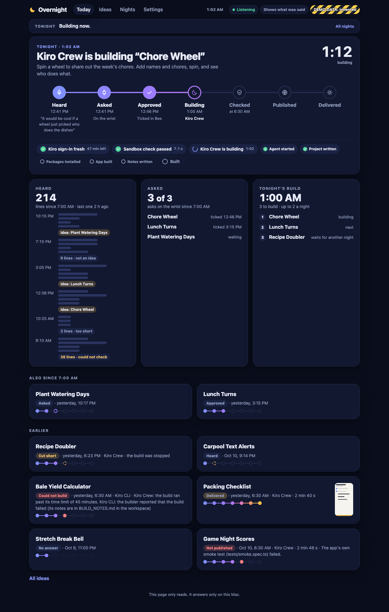

# Overnight

> Say it at lunch. Use it at breakfast.

Overnight listens through [Bee](https://bee.computer/) (on an Apple Watch) for the moments you say "someone should build...". It asks on your wrist whether to build the idea. While you sleep, [Kiro](https://kiro.dev/) builds a small working web app; Overnight then tests and publishes it. In the morning your watch buzzes with the link.

Built for Amazon's "Build, Ship, Shape" developer hackathon (Bee track, plus the AWS Builder side prize). The full plan is in [SPEC.md](SPEC.md).

## Status

| Milestone | What | State |
|---|---|---|
| 0 | Prove each outside piece (Bee, Kiro, GitHub Pages) with a small script against the real tools | Done. Results in [docs/spikes.md](docs/spikes.md) |
| 1 | Hear, notice, ask: an always-on listener that saves what Bee hears, spots ideas with Kiro, asks through a Bee to-do and tracks the answer | Done. Running on real Bee data; the first real idea was heard, asked about on the wrist and approved on Oct 10 |
| 2 | Build and deliver: Kiro Crew builds approved ideas overnight; Overnight tests, publishes and sends the link | Done. **The first real night, Oct 10 to 11, worked end to end** (see below) |
| 3 | Dashboard and hardening: a read-only page that shows the night; Overnight's own clock for the night jobs; finished builds kept out of the builders' reach; a monthly ceiling on build credits | Built and reviewed; its tests pass. **Not yet proved against the real tools, and not yet what runs at night** (see below) |
| 4 to 5 | Real nights, submission | Later |

So today Overnight hears, notices an idea, asks on the wrist, builds overnight, publishes and delivers, for real. What has and has not been proven:

- **Proven for real, on scratch data:** Kiro Crew and Kiro CLI each built an invented app inside Overnight's sandbox. The morning's checks ran on apps a Kiro agent built, and on apps made to misbehave. Stopping a build or a delivery half-way leaves nothing running and nothing stuck.
- **Rehearsed for real on Oct 10:** an invented idea went the whole way with the real Kiro Crew install inside the sandbox: built in 2 minutes 19 seconds, checked, published by the real publisher and live 21 seconds later, at [practice-dice-roller](https://hturcotte1.github.io/overnight-apps/practice-dice-roller/). Bee was a stand-in. The backup builder (Kiro CLI) and the morning's checks also ran as a background job, the way the night jobs do.
- **The first real night, Oct 10 to 11:** an idea heard through Bee and approved on the wrist the morning before was built overnight by Kiro Crew in 2 minutes 40 seconds, checked, published, and put on the wearer's Bee to-do list with its link, with nobody touching the Mac: [plant-watering-tracker](https://hturcotte1.github.io/overnight-apps/plant-watering-tracker/). Both night jobs ran an hour late, because macOS's scheduler was still on the time zone the Mac had before its last restart; a restart fixes that.
- **Milestone 3, built on Oct 11:** the hour-late night is why Overnight now keeps its own time. The dashboard has been run on invented data and on the rehearsal's scratch folder. Everything else in Milestone 3 has only met tests and stand-ins so far. **Still pending:** the new sandbox rules against a real Kiro Crew and a real Kiro CLI build; the every-minute jobs under the real macOS job system; a real sleep of the Mac in the middle of a run; whether the Mac stays awake on battery; this README tried from a clean clone; moving the live night jobs over to the new code; the first night on Overnight's own clock; and the dashboard on real data. [SPEC.md §10](SPEC.md) has the list.

## How the listening half works

```
Apple Watch (Bee app) ──► Bee cloud ──► bee stream
                                           │
                              ┌────────────▼────────────┐
                              │ overnight listen        │  always on (launchd)
                              │  save every line        │──► SQLite in ~/.overnight
                              │  2 quiet minutes?       │
                              │  ask Kiro: an idea?     │──► kiro-cli, no tools
                              │  ask on the wrist       │──► bee todos create (alarm)
                              │  ticked or deleted?     │◄── bee todos get (polling)
                              └─────────────────────────┘
```

- **Hear.** Every utterance is saved the moment it arrives. Bee deletes very short recordings a few minutes later, and those are exactly where one-sentence ideas live.
- **Notice.** After two quiet minutes, the new lines of that conversation go to Kiro CLI running a custom agent with no tools. The reply is checked against a schema; the quote it gives must be word for word from the conversation.
- **Ask.** A real, buildable, non-repeated idea becomes a Bee to-do, `💡 Build tonight? <title>`, with an alarm two minutes out. That buzzes the phone and the watch. At most three asks a day, none at night.
- **Answer.** Ticking the to-do means yes. Deleting it means no. No answer by 11 pm means it expires.

Overnight starts **paused** ("quiet mode"): it listens, saves and detects, but never asks. `npx overnight resume` turns asking on.

## How the building half works

```
approved idea
     │
┌────▼──────────────────────┐
│ overnight build   1:00 am │  writes a one-page brief, then one Kiro Crew job per idea
│  Kiro Crew builds the app │  inside Overnight's own sandbox (fallback: Kiro CLI, also sandboxed)
└────┬──────────────────────┘
     │ a folder with the app in it, moved out of the builders' reach
┌────▼──────────────────────┐
│ overnight deliver 6:30 am │  rebuilds and tests the app inside a tighter sandbox,
│  test, publish, tell      │──► GitHub Pages ──► bee todos create (7:00 alarm), bee facts create
└───────────────────────────┘
```

- **The brief.** The build agent is given one page: our own fixed instructions, plus a cleaned title and a short pitch that the detector wrote. Never the quote, never other transcript text, never names.
- **Build.** At 1:00 a.m. each approved idea (at most two a night) is built as a small static web app with Vite and TypeScript. Kiro Crew goes first; if it fails or can't start, Kiro CLI gets one try.
- **A sandbox around the builder.** A sandbox is a set of rules macOS enforces on a program and on everything it starts. The build agent can't read the GitHub login, the Bee login, what Bee heard, or the rest of the home folder, and it can't write anywhere a program is started from. Before each night's builds, a check that costs no Kiro credits has to prove that, or nothing is built with Kiro Crew that night.
- **Finished builds are put away.** As soon as an app is built, its folder is moved to a place no build job can reach, and its files are copied afresh, so a later build cannot change an app that is waiting for the morning.
- **Test.** At 6:30 a.m. Overnight rebuilds each app from a clean copy and tests it in a headless browser (a browser with no window), inside a second, tighter sandbox. There the app's code can reach nothing on the network except our own test server on this Mac and, when a package is missing, the npm registry. Only what passes is published.
- **Deliver.** The link goes into a Bee to-do, `☀️ Built overnight: <title> → <link>`, with its alarm at 7:00 a.m. If an app couldn't be finished, the wearer gets one `🌙 Couldn't finish` note. An app that is late buzzes two minutes after it is ready, and never between 11 p.m. and 7 a.m.
- **One more try.** A build that was stopped or cut off (the Mac restarted or went to sleep, the job was stopped) is not counted as a failure. The next nightly run builds it once more, and nobody is told unless that fails too.
- **A monthly ceiling.** Overnight counts the Kiro credits its builds use and stops building for the month at `MAX_BUILD_CREDITS_PER_MONTH` (400 unless you set it). Nothing buzzes; `npx overnight status` says why.

The sandbox is a fence, not a sealed box. The network is open during a build, and a few other limits remain. [SPEC.md §9](SPEC.md) lists exactly what a build job can and cannot reach.

## How the night jobs keep time

On the first real night macOS's own calendar started both night jobs an hour late. So since Milestone 3 macOS no longer decides when a night runs:

- macOS starts each night job every minute. Each start asks **Overnight's own clock**, which goes by the `TZ`, `BUILD_TIME` and `DELIVER_TIME` settings, whether it is time. Nearly every start finds it is not yet time and ends at once, without printing anything.
- **Each day's build and each day's delivery start at most once.** The start is written down before the work begins.
- **A missed night catches up.** If the Mac was asleep or switched off at 1:00, the build starts a minute or two after it is awake again, any time before the next night's build. The morning's delivery does the same, and gives a build that is running late 20 minutes to finish first.
- **No internet, no start.** A run waits until the internet answers, because a build or a publish started without it would fail for good.
- **If the Mac sleeps in the middle of a run,** the run is stopped when it wakes. A build stopped that way on its first start gets one more try on a later night; one that was already on its second start counts as failed.

`npx overnight status` shows the last and the next build and delivery, whether each was on time, and what a run that is due is waiting for. After changing `TZ`, `BUILD_TIME` or `DELIVER_TIME`, install the two night jobs again (see "Setting up the night"): that starts their clocks from now.

None of this has run under the real macOS job system yet, and the live jobs on the author's Mac are still on macOS's calendar until they are moved over. Both are pending.

## The dashboard



A web page on this Mac that shows the night as it happens: what was heard (as counts and bars, never the words), what was asked, what is being built, and each idea's story from "heard" to "delivered". It only reads, and it answers only on this Mac.

```bash
npm run dashboard:demo            # invented data: the way to have a look
npm run dashboard:demo -- --play  # the same, and an invented night ticks through (about 70 seconds)
npm run dashboard                 # Overnight's real data
npm run dashboard:filming         # real data with what was said hidden
```

- **It opens from its own link.** The command prints a link that starts with `http://127.0.0.1:4321/?key=`. The page opens from that link and shows nothing without it. The key is new every time the dashboard starts. If the page says "The dashboard has stopped or was restarted. Open its new link.", start it again and use the new link.
- **The demo** shows invented ideas in every state, marked "DEMO DATA: invented" on every page. Nothing real is opened. `npm run dashboard:demo -- --port 4322` puts it on another port.
- **Filming mode** hides every quote, the ideas nobody has approved and the build notes. `npm run dashboard -- --filming --show-quote <ideaId>` lets one idea's quote through, for a speaker who agreed to be filmed.
- **The lines Bee heard are never shown,** in any mode. What the page can show of speech is each idea's short quote, unless you are filming.
- **Options go after the two dashes** (`npm run dashboard -- --filming`). Typed before them npm keeps them for itself; the dashboard notices and refuses to start rather than start without them.
- Stop it with Ctrl-C.

One honest footnote: when no other Overnight program is running, the database library itself leaves two small side files next to the database when the dashboard reads it (`overnight.db-shm` and an empty `overnight.db-wal`). The database does not change, and the next Overnight command removes them.

More pictures, all from the invented demo data: [on a phone](docs/images/dashboard-today-phone.png), [one idea](docs/images/dashboard-idea.png), [the nights](docs/images/dashboard-nights.png). They were taken on Oct 11, before the last round of small changes to the look. The dashboard has not yet been looked at on the real data folder; that is pending.

## What's in the repo

| Path | What it is |
|---|---|
| `SPEC.md` | The build spec and source of truth |
| `packages/core` | Shared types, settings, the idea state machine, logger, SQLite store, the night clock and the count of build credits |
| `packages/bee` | The only code that talks to Bee, through the official `@beeai/cli` library. It strips transcripts and names out of events before anything else sees them |
| `packages/detector` | The idea detector (Kiro CLI, no tools) and its evaluation script |
| `packages/listener` | The always-on logic: save, detect, ask, track answers, catch up after a disconnect |
| `packages/builder` | The night: the brief, the two builders (Kiro Crew and Kiro CLI), their sandbox rules, the nightly sandbox check, and putting finished builds away |
| `packages/deliver` | The morning: test a built app inside a sandbox, publish it, tell the wearer |
| `packages/dashboard` | The read-only dashboard and its invented demo data |
| `packages/cli` | The `overnight` command |
| `crew/` | What the build agent is told: the build skill and the one-sentence job message. [crew/README.md](crew/README.md) explains how one build runs |
| `fixtures/detector/` | 66 synthetic transcripts the detector is scored against. Each file's first line says it is synthetic |
| `launchd/`, `scripts/install-agents.sh` | The four macOS background jobs: the listener, the Kiro Crew gateway, the nightly build, the morning delivery. The last two wake every minute and ask Overnight's own clock |
| `spikes/` | The Milestone 0 scripts, one from Milestone 2 and three from Milestone 3 (10 to 12) |
| `docs/` | Spike results, the friction log (every surprise with Bee, Kiro and Playwright), product feedback per tool, and pictures of the dashboard |

## Setup

**Tried on one Mac only:** Apple silicon, macOS 26, Node from nodejs.org unpacked under the home folder, and the other tools in `~/.local/bin`. Following these steps on a fresh Mac from a clean copy of the repo has not been tried yet; that is pending.

You need:

- **A Mac with `git`.** A fresh Mac offers to install Apple's Command Line Tools the first time `git` is used.
- **[Node.js](https://nodejs.org/) 22.18 or newer** (we use 24). The installer looks for it at `~/.local/node/bin/node` first, then for `node` on the `PATH`. Only a Node from nodejs.org has been tried. The morning's sandbox opens `npm` inside Node's own folder by name, and another way of installing Node may keep it somewhere else.
- **An iPhone with the Bee app and an Apple Watch paired with it.** In Bee choose "Try with Apple Watch", turn Developer Mode on (in Bee's Settings, tap the app **Version** five times), and **allow notifications for Bee** on the iPhone.
- **[Kiro CLI](https://kiro.dev/docs/cli/) signed in** (`kiro-cli login`) on a plan with credits. The detector uses about 0.02 Kiro credits per conversation.
- For the night, later: Kiro Crew, the GitHub CLI and a test browser (see "Setting up the night").

The steps, in this order:

```bash
git clone https://github.com/hturcotte1/Overnight.git
cd Overnight
npm install

# Settings. Then open .env and set TZ to your own time zone.
cp .env.example .env

# Switch off Kiro's content sharing. This is a required step, not only advice (see below).
kiro-cli settings codeWhisperer.shareCodeWhispererContentWithAWS false
kiro-cli settings telemetry.enabled false

node spikes/00-bee-login.ts     # prints a link; open it, scan the QR code with the phone, approve in Bee
node packages/bee/src/smoke.ts  # read-only check: prints "loginState: logged-in"
npm test
```

- `npm install` downloads the Bee CLI, which is about 480 MB. npm may warn that it skipped an install script for `@beeai/cli`; that's harmless.
- **`TZ`** decides when Overnight asks, builds and delivers, whatever zone the Mac's own clock is in. It starts as `America/Boise`.
- **The two Kiro settings.** By default Kiro may use what it is sent to improve its service, and the detector sends it what was said. The Kiro CLI builder also refuses to build unless both settings read "false", and a setting that was never set does not count. On a brand-new Kiro install these commands also create two files that a sandboxed build needs to find in place.
- Whether `npm test` passes on a Mac with no Kiro, no GitHub CLI and no test browser has not been tried (pending, with the clean-clone trial). The dashboard's browser tests are skipped when the test browser is not installed.

## Running it

```bash
npx overnight status            # mode, what has been heard, ideas, asks today, build credits, and tonight's plan
npx overnight listen            # run the listener in this terminal (Ctrl-C to stop)
npx overnight ideas             # today's ideas and what happened to each
npx overnight resume            # turn asking on (it starts paused)
npx overnight pause             # back to quiet mode
```

To keep the listener running in the background (it starts at login and restarts if it stops):

```bash
scripts/install-agents.sh install listen
scripts/install-agents.sh status listen
scripts/install-agents.sh uninstall listen
```

Always name the job. With no job named, `install` and `restart` act on all four jobs, which also stops and restarts a listener that is running.

Only one listener runs per data folder; a second one refuses to start. Logs are in `~/.overnight/logs/`. Overnight's own logs hold ids, counts and states, never what was said.

Settings go in `.env` (copy `.env.example`). The defaults: at most 3 asks a day, asks expire at 23:00, nothing is asked between 23:00 and 07:00, builds at 01:00, delivery at 07:00, at most 2 builds a night, at most 400 counted Kiro credits of builds a month, time zone America/Boise.

## Setting up the night

The night needs three more things than the listener: Kiro Crew, a GitHub login for publishing, and a browser for the tests.

**What to have in place first**

- [Kiro Crew](https://kiro.dev/) 0.8.0, with its program at `~/.local/bin/kirocrew` (where its own installer puts it). On a fresh install `kirocrew doctor` complains about a voice feature until you run `kirocrew config set stt.enabled false`; after that it ends with "Kiro Crew is ready". ([docs/spikes.md](docs/spikes.md) says how this Mac was set up.) A build has cost between 2.6 and 4.6 Kiro credits so far.
- The [GitHub CLI](https://cli.github.com/) logged in (`gh auth login`, then `gh auth setup-git`). The night jobs look for `gh` only in macOS's own folders, in Node's folder and in `~/.local/bin`, so put it in one of those. `preflight` says "not logged in, or was not found" when it is somewhere else.
- A public repo for the apps with GitHub Pages turned on and an empty `.nojekyll` file at its root. Its name goes in `GITHUB_PAGES_REPO`.
- Playwright's headless browser: `npx playwright install --only-shell`.
- `npx overnight resume`, if Overnight is still in quiet mode. Nothing is built while it is paused.

**The steps, in this order**

```bash
# 1. The one Kiro Crew setting Overnight needs (see below for why).
~/.local/bin/kirocrew config set agent.sandbox_allow_unsandboxed_exec true

# 2. The Kiro Crew gateway, inside Overnight's sandbox. Also installs the build skill.
scripts/install-agents.sh install crew

# 3. Check everything tonight needs: thirteen lines, each with a tick or a cross and the fix.
#    (Until step 4 the night-jobs line shows a cross, and the line about their clock a dash.)
npx overnight preflight

# 4. The nightly build (01:00) and the morning delivery (06:30). Each looks at the clock once
#    when it is installed and every minute after. Nothing is built or delivered until its time.
scripts/install-agents.sh install build
scripts/install-agents.sh install deliver

# 5. Check again. It should end with "Ready".
npx overnight preflight
```

- If Kiro Crew's own setup already started a gateway, step 2 stops and says what to do.
- **Installing a night job starts its clock from now.** A run that was still due today is skipped, and the first run is at the job's next time. So do not install one within a minute of the build time or of 6:30, and install both again after changing `TZ`, `BUILD_TIME` or `DELIVER_TIME`.
- If `preflight` says a night job has not checked the time, and the Mac has only just woken, wait two minutes and run it again before reinstalling anything.

**Why that one Kiro Crew setting.** Kiro Crew has a sandbox of its own, but on a Mac it leaves the GitHub login, the Bee login and the saved transcripts within a build job's reach (measured; see [docs/spikes.md](docs/spikes.md)). So Overnight starts the whole Kiro Crew gateway inside its own, stricter sandbox. macOS can't put one sandbox inside another, and Kiro Crew refuses to run any job inside a sandbox it did not make unless this setting is on. Turning it on switches Kiro Crew's own sandbox off, and Overnight's takes its place. The installer never changes the setting for you: it stops and prints the command, because it is the owner's decision.

If you would rather not change it, set `BUILD_SANDBOX=crew` in `.env`. Kiro Crew's own sandbox is then used at its strict level, which does not protect those three things.

**When to run `install crew` again.** After changing `crew/build-skill.md`, after the sandbox rules change (`packages/builder/sandbox/crew-gateway.sb`, for example after pulling a new version: the last check of `preflight` says when the gateway job's copy of the rules is not the repo's), after changing `BUILD_SANDBOX`, and after updating Kiro Crew or Node.js: the gateway's job holds the full paths of both programs.

**What to leave on overnight**

- The Mac logged in. Background jobs only run for a logged-in user.
- **Plugged in to power, or with the lid open.**
  - Plugged in is what has been seen to work: on the first real night the Mac was on mains power with its lid closed.
  - On battery with the lid open, Overnight asks macOS to stay awake, so that it keeps listening and can build. That runs the battery down. Whether it holds on this Mac has not been tried yet (pending).
  - **With the lid closed on battery nothing runs.** The Mac sleeps whatever is asked. Nothing is heard until it is opened, and a build that was due starts a minute or two after (or a minute or two after the Mac is plugged in).
  - A sleeping Mac wakes by itself for a moment now and then. Overnight starts no build and no delivery in such a moment: while the Mac is on battery with its lid closed, a run that is due waits, and `npx overnight status` says "waiting for the lid to be opened or the Mac to be plugged in". This has met tests only, not yet a real closed lid (pending).
- The phone with Bee on it, with notifications allowed, so the 7:00 alarm can buzz.

**In the morning**

```bash
npx overnight status                     # "Last build", "Last deliver", "Last delivered", and what waits for tonight
scripts/install-agents.sh status build   # how it is started, the last exit code and the last log lines
scripts/install-agents.sh status deliver
```

Logs are `~/.overnight/logs/build.log` and `deliver.log`.

## Rehearsing

A rehearsal tries the night and the morning on an invented idea. It can never reach Bee, and it refuses to run on the real data folder, so nothing lands on anyone's wrist.

```bash
# Add one invented idea, already approved. Prints its id.
OVERNIGHT_DATA_DIR=~/.overnight-rehearsal npx overnight rehearse new "Zebra Dice Roller" "Roll one to six dice on a phone and show the total."

# Build it for real and test it for real. --no-publish keeps it off the public page.
OVERNIGHT_DATA_DIR=~/.overnight-rehearsal npx overnight rehearse run <id> --no-publish
```

- The scratch folder must be named on the command itself, as above. A value that only comes from `.env` is refused.
- The real data folder is refused however it is spelled: by a link, in other capitals, or by one of macOS's other names for the same place. So are the folders the installed background jobs use.
- The rehearsal on Oct 10 used a scratch folder in the home folder, like the one above. A scratch folder under `/private/tmp` (which the command's own message suggests) has not held a real build yet.
- Use made-up words for the title and pitch. Without `--no-publish` the app is published for real, on the public apps page. Use a new title each time you publish: a title that is already on the apps page under another idea stops the publish.
- What Bee would have been told is written to `rehearsal-bee.log` in the scratch folder.
- A rehearsal uses real Kiro credits, counted in the scratch folder's own ledger.
- A scratch folder that holds a rehearsal idea is a rehearsal folder: `listen`, `build`, `deliver` and `build-now` refuse to run on it.
- The Kiro Crew gateway's sandbox is tied to the one data folder it was installed for. A rehearsal uses a different folder, so with the installed gateway we expect the sandbox check to fail and the build to fall back to Kiro CLI. (That comes from reading the rules; it has not been run.) Rehearsing a Kiro Crew build needs a gateway started for the scratch folder, which is how the Oct 10 rehearsal was done.
- To try one real idea right away instead, `npx overnight build-now <ideaId>` builds and delivers it. That one uses the real Bee: in the daytime the wrist buzzes two minutes later.

## Backing out

**Stopping the night.** In this order. The listener and all saved data are left alone.

```bash
scripts/install-agents.sh uninstall deliver   # first, so a stopped build can't send a "couldn't finish" note
scripts/install-agents.sh uninstall build
scripts/install-agents.sh uninstall crew
~/.local/bin/kirocrew config set agent.sandbox_allow_unsandboxed_exec false   # Kiro Crew's own sandbox back on
```

- `npx overnight pause` stops asking and building, but an app that is already built is still delivered in the morning. To stop the morning as well, uninstall the `deliver` job.
- `install crew` keeps a build skill it replaced beside the new one, as `SKILL.md.bak-<time>` in `~/.kiro/crew/skills/overnight-build/`.
- A published app stays public until its folder is removed from the apps repo.
- Installing the night jobs again later starts their clocks from now.

**Going back from the Milestone 3 code to the Milestone 2 code.** This matters once the night jobs run the new code. Do it in the daytime, with no build or delivery running, and do every step: the old code does not know about the new folders or the new way the jobs are started. (Written from trials on scratch copies; it has not been needed on the real system.)

1. **Move finished builds back.** The old code only looks for a built app in `workspaces/`. Move every folder in `~/.overnight/built/` that is named exactly after an idea back into `~/.overnight/workspaces/`. Leave the rest where it is: the folders named `<id>.old-<time>`, a folder named `<id>.sealing` if there is one, and the file `.overnight-probe-marker`. If you skip this, the old code fails each good app that was waiting ("The app's folder does not exist.") and tells the wearer it could not be finished. The same goes for an app whose publish failed and that you mean to publish again with `build-now`.
2. **Check out the previous version of the code.**
3. **Straight away, reinstall all four jobs with the old installer**, one at a time: `install build`, `install deliver`, `install crew`, then `restart listen`. Until the first two are done, both night jobs fail once a minute (the new job files start the old code with a switch it does not know), build and deliver nothing, and fill their `*.launchd.log` files by about 12 MB a day. The old `status` and `preflight` do not say so.
4. **Check.** `scripts/install-agents.sh status build` shows "runs at: 01:00", and the last lines of `~/.overnight/logs/build.launchd.log` are no longer the command's help text. Then `npx overnight preflight`.
5. **Remember what comes back with the old code:** the night jobs are on macOS's calendar again, so if the Mac's time zone has changed since it last restarted, restart it once; and the listener keeps the Mac awake on mains power only.

What can stay as it is: the new table and the night clock's values in the database, and the `built/` and `sandbox/` folders. The old code ignores them (tried on a scratch copy: it opened the newer database, built and delivered on it, and left the new parts alone).

## Tests and checks

```bash
npm test                 # unit tests; none calls Bee, spends Kiro credits or publishes anything
npm run typecheck
npm run lint
npm run eval:detector    # runs the 66 synthetic transcripts through the real detector (about 1 Kiro credit)
```

On a Mac, some tests start the real macOS sandbox around harmless commands in made-up folders, to check that the sandbox rules refuse what they should. If Kiro's tools are installed, those tests also ask them for their version number. If Playwright's test browser is installed, the dashboard's tests open its pages in it.

`npm run eval:detector` uses the data folder `.env` names, like every other command. With no `.env` it uses `~/.overnight`. It only ever sends the synthetic transcripts.

The detector's last evaluation: precision 1.00 and recall 1.00 on 66 synthetic transcripts (targets: 0.85 and 0.7). That measures the plumbing and the prompt on made-up speech, not real-world accuracy.

## Privacy

- Bee hears everyone nearby. If you wear it, tell the people around you.
- Transcripts stay on your Mac in `~/.overnight`, in files only your user can read. They are never committed to this repo.
- Two things leave the Mac. The first is what the detector sends to Kiro. Turn off Kiro's content sharing first (the two `kiro-cli settings` commands in Setup); the detector also switches both off in its own settings folder, and refuses to run if it can't. The second is the one-page brief, which Kiro reads to build the app. It holds a title and a pitch the detector wrote, with names left out.
- The detector hands Kiro its text on standard input, not on the command line, so other programs on the Mac can't read it from the list of running programs.
- Bee's "conversation finished" event contains the whole transcript and first names. `packages/bee` drops all of that; nothing downstream can store or log it.
- The build agent and the code it writes only ever run inside a sandbox. [SPEC.md §9](SPEC.md) says exactly what it can and cannot reach, including the limits that remain.
- The dashboard only reads, answers only on this Mac and only from its own link, and never shows the lines Bee heard. It does show each idea's short quote unless it is started in filming mode.
- Test fixtures are synthetic and say so on their first line.
- Everything Overnight publishes is public, so build briefs never contain personal details.

## License

[MIT](LICENSE)
